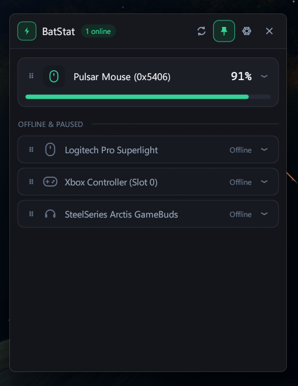
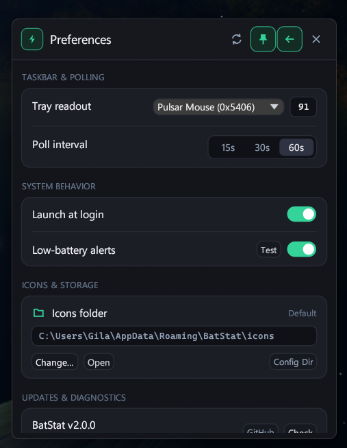
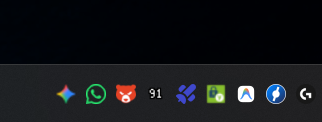

# BatStat ⚡

**BatStat** is a lightweight, native Windows 11 system tray battery monitor for wireless gaming peripherals, written in Rust. It sits quietly in your taskbar, renders live battery percentages or low-battery alert icons directly in the system tray, and opens a sleek Windows 11 DWM rounded-corner flyout with a single click.

## Screenshots

| Devices Flyout | Preferences & Tray Setup |
| :---: | :---: |
|  |  |
| *Live battery cards, `⋮⋮` drag-to-reorder priority, and compact offline rows* | *Tray `%` readout preview, `15s/30s/60s` poll selector, autostart, and configurable icons folder* |

<p align="center">
  
  <br />
  <em>Crisp dynamic pixel-art battery percentage (<code>91</code>) rendered directly in the Windows 11 system tray</em>
</p>

## Features

- 🪟 **Native Windows 11 Tray Flyout**: Single left-click toggles a borderless DWM rounded-corner flyout anchored right above your system tray icon (multi-monitor & DPI aware). Click outside or press `Esc` to dismiss, or drag the header to move and auto-pin it open.
- 🔢 **Live Taskbar `%` Readout & Smart Cycling**: Pin any device channel's live battery percentage as a crisp pixel-art tray icon (emerald green while charging), or let BatStat automatically cycle between low-battery alert icons at a 3-second interval.
- 🔋 **Single & Multi-Channel Telemetry**: Queries both single-battery mice/controllers and multi-channel peripherals (independent Left / Right earbud & charging case levels).
- ↕️ **Drag-and-Drop Priority & Custom Alert Icons**: Drag `⋮⋮` grips to reorder device priority across both the flyout and right-click tray menu. Click any device to expand its inline drawer with nickname editing, smooth alert threshold slider, 5 quick color tint swatches, `.png` / `.ico` drag-and-drop import, and a configurable **Icons folder**.
- ⚡ **Instant Auto-Save & Native Rendering**: Every toggle, slider, rename, and priority change saves automatically with zero "Save" buttons, no WebView, and an idle UI loop while hidden.
- 🔄 **Autostart, Native Alerts & Built-in Updater**: Launch automatically at Windows login, receive desktop low-battery toast notifications (with one-click `Test`), and check/install `.msi` updates directly from GitHub Releases.

## Supported Hardware

BatStat uses a modular plugin architecture to scan and query wireless peripherals directly without heavy vendor bloatware. For full protocol details, vendor/product IDs, and interface filters, see the [Supported Devices List](DEVICELIST.md).

1. **Pulsar Wireless Gaming Mice** — Direct vendor HID queries (exact battery `%` and charging state).
2. **Logitech LIGHTSPEED Gaming Mice** — Direct HID++ 2.0 (`0x1004` Unified Battery) queries with automatic sleep/offline state fallback.
3. **Xbox Wireless Controllers** — Modern `Windows.Gaming.Input` (WGI) WinRT telemetry for Xbox One, Series X|S, and Elite controllers.
4. **SteelSeries Arctis GameBuds** — Dual-channel HID queries for independent Left and Right earbud battery percentages and connection status.

## Installation & Building

### Installer (Recommended)

Download the latest `.msi` installer from [**GitHub Releases**](https://github.com/SGiehler/BatStat/releases/latest).

### Building from Source

#### Prerequisites

- [Rust Toolchain](https://rustup.rs/) (stable MSVC target)
- Windows 10 / 11

```bash
git clone https://github.com/SGiehler/BatStat.git
cd BatStat
cargo build --release
```

The compiled executable will be located at `target/release/batstat.exe`.

## Configuration

Settings and custom tray icons are stored automatically in `%APPDATA%\BatStat`:

- `config.toml` — Device priorities, nicknames, alert thresholds, poll interval, tray readout channel, and custom icons path.
- `icons\` — Built-in, color-tinted, and imported `.png` / `.ico` alert icons (relocatable via **Preferences → Icons folder**).

## License

This project is licensed under the [Creative Commons Attribution-NonCommercial-ShareAlike 4.0 International License](LICENSE).
